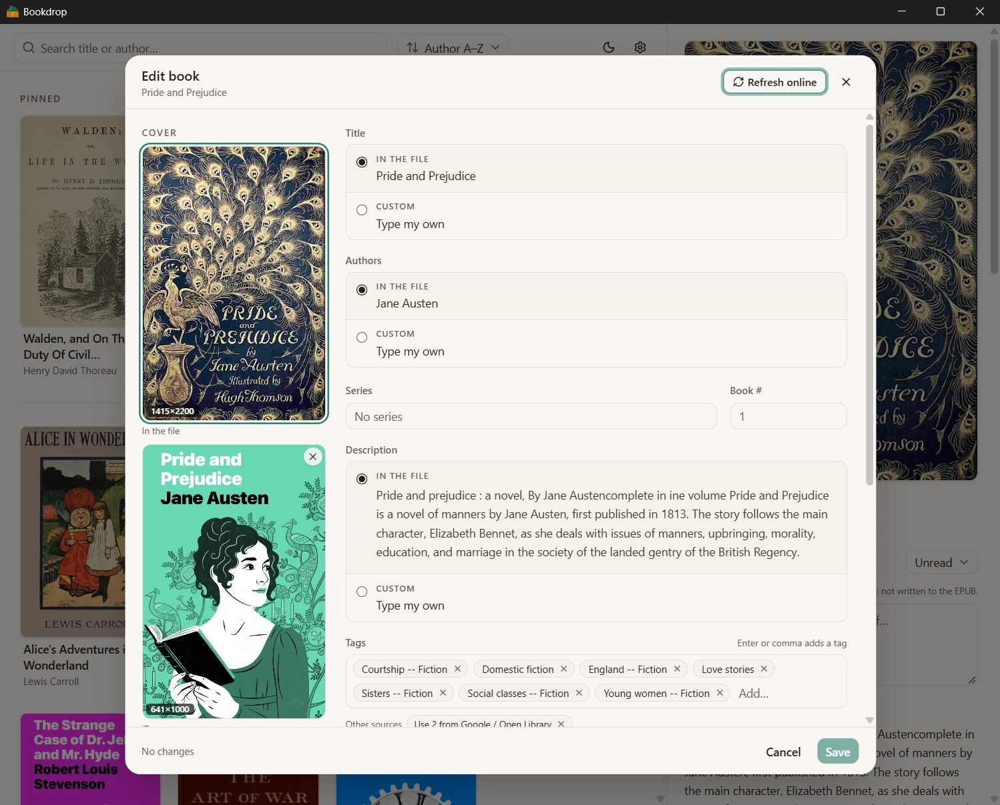
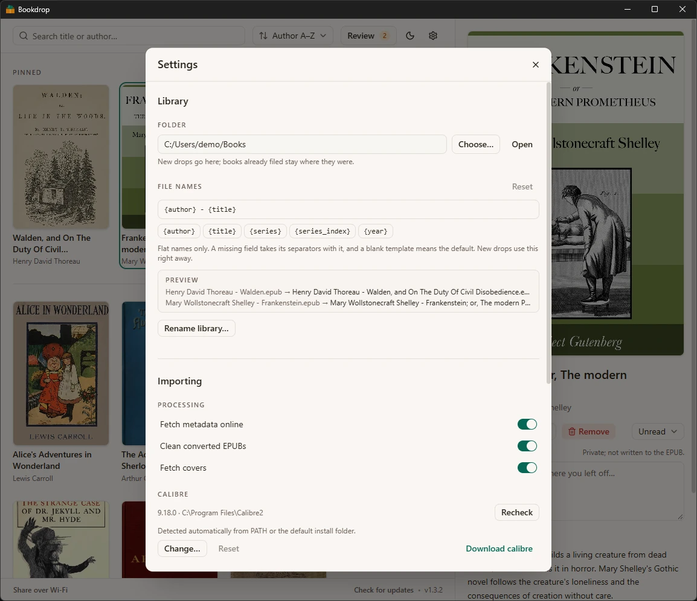
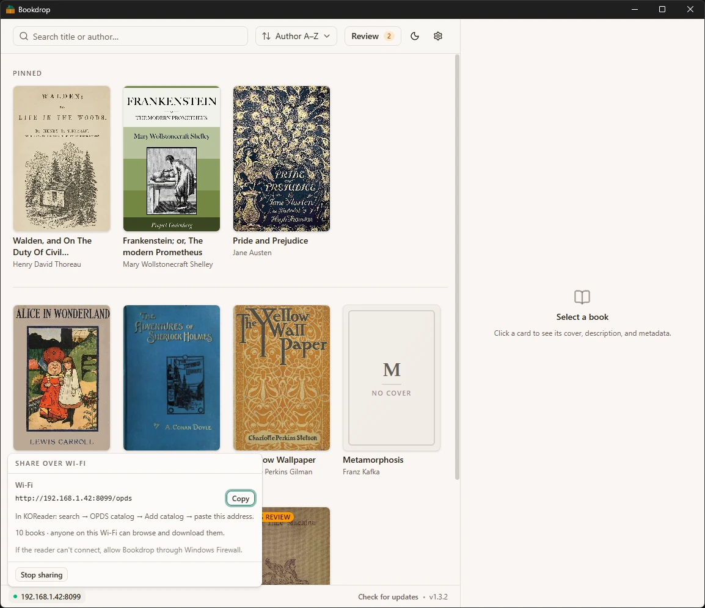

# Bookdrop

Bookdrop is a Windows app that keeps your ebooks in one tidy library. Drop
EPUB, PDF, MOBI, AZW3, RTF, DOCX, HTML, or TXT files into the window. It
converts them to EPUB, looks up the title, author, and cover, and saves them
into a single folder you can copy to your e-reader. It also keeps a simple
reading log for each book.

No account. No telemetry. The library itself is just EPUB files in a folder.

**[Download the latest version from the Releases page](https://github.com/UmutSen2662/bookdrop/releases)** — Windows 10 or 11, 64-bit · [calibre](https://calibre-ebook.com/) required


*The library, with the details panel open.*

## What it does

- **Adds books by drag and drop.** Files are converted to EPUB and filed
  automatically. Anything that fails, or whose file later goes missing, is
  listed in Needs attention.
- **Fills in metadata and covers.** It looks up details from the file itself,
  Google Books, Open Library, and iTunes, and lets you pick the best match.
  Nothing changes in a book until you save.
- **Finds what needs a second look.** The Review popover collects books whose
  metadata is uncertain and books with no cover.
- **Tracks reading.** Mark each book as Unread, Reading, or Finished, and add
  private notes. Notes are stored in Bookdrop's database, not inside the EPUB.
- **Keeps one flat folder.** There are no author or series subfolders. File
  names come from a template you can change in Settings; see
  [File names and the library folder](#file-names-and-the-library-folder).
- **Works with the keyboard.** Arrow keys move through the grid. On a wide
  window the details panel follows; on a narrow one, arrows only move focus and
  Enter opens the book. `/` or `Ctrl+F` searches, and Escape clears the search
  or closes the panel.
- **Shares over Wi-Fi.** Send books to a KOReader device on the same network
  without a cable. See
  [Sending books to a reader over Wi-Fi](#sending-books-to-a-reader-over-wi-fi).



*Fetched values stay in the editor until you save.*

## File names and the library folder

Bookdrop keeps one flat folder: no author or series subfolders. That makes the
library easy to sync, copy, and hand to any e-reader.

File names come from a template. The default is `{author} - {title}`, and
Settings has tokens for author, title, series, series index, and year. A live
preview shows the new names before anything moves, and **Rename library…**
applies the template to books already in the folder.

If you change the library folder, books left behind are marked **outside
library** until you move them. Bookdrop re-attaches them by file hash on the
next start.



*The File names section in Settings: template, tokens, preview, and Rename
library.*

## Sending books to a reader over Wi-Fi

Click **Share over Wi-Fi** in the footer. Bookdrop shows the address, a Copy
button, and how many books are included.



*Share over Wi-Fi gives you the address to paste into KOReader.*

1. On a device running [KOReader](https://koreader.rocks/), open the search
   menu, choose **OPDS catalog**, then **Add catalog**, and paste the address.
2. Browse the list and download the EPUBs you want.
3. Click **Stop sharing** when you are done. Sharing also stops when you close
   Bookdrop or lose the network.

The catalog includes every book that has a readable file, including books still
in Needs attention. Books without a readable file are left out. The list is
sorted by title and can be searched from KOReader.

<details>
<summary>Network notes and troubleshooting</summary>

- The connection is plain HTTP on your local network, with no password. Anyone
  on the same network who has the address can see and download the library. Only
  share on networks you trust.
- The port is 8099, so it does not clash with calibre's server on 8080.
- The first time, Windows may ask whether to let Bookdrop through the firewall.
  If the reader cannot connect, check that prompt, and check whether the network
  is set to Public.
- The address changes if the computer's IP address changes. Each address is
  labelled with its network adapter (Wi-Fi, VPN, vEthernet), and only the one on
  the reader's network will work. To keep the address stable, set a DHCP
  reservation on your router. Bookdrop refreshes the list each time you open it.
- Names like `terra.local` need mDNS support on the reader. Kindle firmware does
  not have it, so use the IP address on a Kindle.
- Nothing is uploaded anywhere.

</details>

## Your data

- **Metadata is only written when you save.** Fetched values and candidate
  covers stay in the editor until you click Save.
- **Reading status, notes, and pins live in SQLite.** The library folder is just
  files you can sync.
- **Missing files do not lose their data.** If an EPUB disappears from the
  library, the book keeps its metadata, status, and notes. It is flagged in the
  grid with Open folder, Recheck, and Remove options.

Bookdrop's own data (config, database, covers, temporary files) is stored in
`%LOCALAPPDATA%\bookdrop`. The library folder can be anywhere you like, and you
can sync it to any device.

Back up that folder: it is the only copy of that data. Close Bookdrop, then copy
it somewhere safe. EPUBs can be re-imported and covers can be regenerated, but
the database cannot be rebuilt. To restore, close the app, put the folder back
in place, and reopen Bookdrop. **Settings → About** opens the location for you.

## Privacy

Bookdrop has no telemetry and no account. Your files stay on your computer.

When the app starts, it checks GitHub for a newer release. That request contains
no library, account, or usage information. When you look up metadata, the book's
title, author, or ISBN is sent to Google Books and Open Library (through calibre),
and to iTunes and Open Library directly. Covers are downloaded from those
services.

Wi-Fi sharing is opt-in and stays on your local network. See
[Sending books to a reader over Wi-Fi](#sending-books-to-a-reader-over-wi-fi)
for the connection details, security notes, and how to stop it.

## Getting started

### What you need

- Windows 10 or 11, 64-bit, with WebView2 (included in Windows 10 version 1803
  and later, and in Windows 11)
- [calibre](https://calibre-ebook.com/) (tested with version 9.18), either on
  your `PATH` or set in Bookdrop's Settings

Bookdrop uses calibre's command-line tools (`ebook-meta`, `ebook-convert`, and
`fetch-ebook-metadata`) to do the conversion and metadata work. calibre is not
bundled with Bookdrop, so install it separately.

If Bookdrop cannot find calibre, dropping is disabled and a banner in the
library tells you so. Open **Settings → Importing → calibre** to choose the
calibre folder, recheck the detection, or reset the override. Installing
calibre and putting it on `PATH` also works.

### Install and update

Download the installer from the
[Releases page](https://github.com/UmutSen2662/bookdrop/releases).

Because the installer is not code-signed, Windows may show "Windows protected
your PC." Click **More info**, then **Run anyway**.

Each release also includes a `SHA256SUMS.txt` file. To check your download, run
this in PowerShell:

```powershell
Get-FileHash .\Bookdrop_*_x64-setup.exe -Algorithm SHA256
```

Compare the result with the matching line in the checksums file.

Bookdrop updates itself. It checks GitHub shortly after you open it, and you can
check manually with **Check for updates** in the footer. When a new version is
ready, click **Update available** and the app will install it and restart.
Versions before 1.1.0 did not have this feature, so install the latest release
manually once. Your library and Bookdrop's data are kept either way.

## Development

You need Bun, Rust 1.90 or later with the MSVC target, and the Visual Studio C++
build tools. Run these from Windows, not WSL:

```bat
bun install
bun run tauri dev
```

For screenshots or demos, `bun run demo` opens the app with an in-memory
library of ten public-domain books. It never reads your real config, database,
or library folder, and it is only available in development builds. Settings,
the edit sheet, and the share popover all open for screenshots; actions that
would touch files or start a server are inert.

Common checks:

```bat
bun run test          :: Vitest: pipeline and helper tests
bun run typecheck     :: TypeScript
bun run lint          :: Biome formatting and linting
cd src-tauri && cargo test
```

UI conventions live in [docs/ui.md](docs/ui.md). The repository contains no
books. For manual testing, use your own files. `samples/` is git-ignored for
local test files. `bun scripts/ingest.ts path\to\book.epub` runs the same steps
as the app and writes to the configured library and database. Environment
variables such as `BOOKDROP_HOME` and `BOOKDROP_LIBRARY` override the config for
scripts and tests.

<details>
<summary>Build, sign, and publish a release</summary>

To build an installer, checksums, and the updater manifest, set the signing key
in the same window that runs the build:

```bat
set TAURI_SIGNING_PRIVATE_KEY=%USERPROFILE%\.tauri\bookdrop.key
set TAURI_SIGNING_PRIVATE_KEY_PASSWORD=your-key-password
bun run tauri build
bun run checksums
bun run latest-json "What changed in this release"
```

Environment variables only apply in the window where you set them. If you open
another terminal, or set them in one tab and build in another, you will see
"a public key has been found, but no private key." In PowerShell, use the
`$env:` form instead, since `set` only creates a local variable there and the
build will still fail:

```powershell
$env:TAURI_SIGNING_PRIVATE_KEY = "$env:USERPROFILE\.tauri\bookdrop.key"
$env:TAURI_SIGNING_PRIVATE_KEY_PASSWORD = "your-key-password"
bun run tauri build
```

Generate the key once and keep it outside the repository:

```bat
bunx tauri signer generate -w %USERPROFILE%\.tauri\bookdrop.key
```

Store the password somewhere safe. If you make a new key pair, you must update
`plugins.updater.pubkey` in `src-tauri/tauri.conf.json`. Installed copies only
trust the key they shipped with, so they will reject builds signed with a
different key.

The build fails without the key, because every build is signed for the updater.
When publishing a release, upload the NSIS installer, its `.sig` file,
`SHA256SUMS.txt`, and `latest.json`. The app reads `latest.json` from the newest
non-prerelease.

</details>

### Tech stack

- **Desktop shell:** Tauri 2, Rust
- **Frontend:** React 19, TypeScript, Vite, Tailwind CSS
- **Data:** SQLite via `tauri-plugin-sql`
- **Testing:** Vitest, Cargo test
- **Tooling:** Bun, Biome

## Not affiliated with calibre

Bookdrop is an independent project. It is not affiliated with, endorsed by, or
sponsored by calibre, which is a separate application by Kovid Goyal. Bookdrop's
own code is MIT licensed and contains no calibre code.

## License

MIT © 2026 Umut Şen. See [LICENSE](LICENSE) and [THIRD-PARTY.md](THIRD-PARTY.md).
